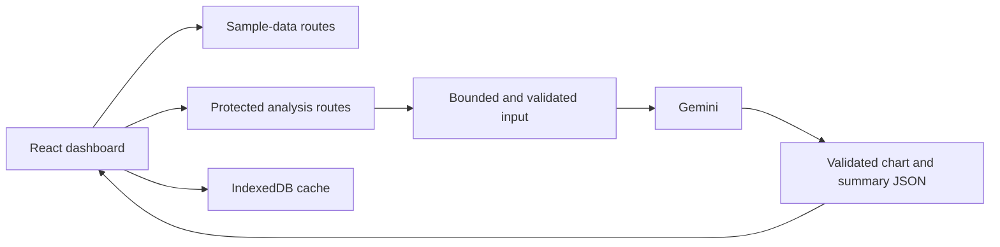

# MoaChart · 모아차트

**Personal project · Full-stack data dashboard · AI-assisted financial-data visualization**

Explore sample financial datasets, turn uploaded data into chart-based summaries, and revisit saved analysis in the browser.

**Stack:** Next.js 16 App Router, React 19, TypeScript, Tailwind CSS 4, Recharts, IndexedDB, Google Gemini.

[Live demo](https://dashboard-hackathon-inky.vercel.app) · [한국어 소개](README.ko.md) · [Security and deployment](SECURITY.md)

## What it does

- Browses sample datasets across stocks, ETFs, portfolios, financial metrics, and other categories.
- Converts uploaded files or text into structured summaries, insights, and chart data through Gemini.
- Supports follow-up prompts that revise an analysis and its visualizations.
- Organizes uploaded analyses, favorites, and recent activity.
- Caches datasets and saved analysis locally with IndexedDB.

**Demo scope:** the built-in financial data is sample data, not a live market feed. The sample dashboard can be explored without a Gemini key. AI analysis requires server configuration and the private demo access code.

## How it works



## Engineering decisions

| Area | Implementation and purpose |
| --- | --- |
| Data-driven charts | Category schemas and reusable chart components connect structured analysis to Recharts visualizations. |
| Local persistence | IndexedDB caches sample datasets and saved analyses; localStorage retains lightweight user preferences. |
| Server-side AI | The Gemini API key stays on the server rather than in the browser bundle. |
| Request boundaries | Both AI routes enforce a streamed 1 MiB body limit and share a per-process request cap. |
| Response handling | Model output is checked before chart fields are merged; unsafe prototype properties and invalid structures are rejected. |
| Failure handling | Provider errors and raw model responses are not returned to clients or logged as uploaded content. |

## Run locally

Use **Node.js 20.19+**. From the repository root:

```bash
npm ci
cp .env.example .env.local
npm run dev
```

Open [localhost:3000](http://localhost:3000). You can browse the sample dashboard before configuring the AI features.

To enable AI analysis, set these server-only variables in `.env.local`:

| Variable | Purpose |
| --- | --- |
| `GEMINI_API_KEY` | Your Gemini API credential |
| `DEMO_ACCESS_TOKEN` | A randomly generated demo access code of at least 32 characters |

The browser asks for the **demo access code**, not the Gemini API key. AI operations are disabled when the server's access code is missing or too short. Environment files must stay outside Git.

## Verify

```bash
npm run test:security
npm run build
```

Security regression tests cover access control, production configuration, rate limits, forged Content-Length values, bounded multipart/JSON parsing, model-output validation, prototype properties, and error redaction. They do not call a paid Gemini service.

CI runs the security tests, dependency audit, production build, and redacted secret scanning.

## Data flow and deployment

Saved analyses and preferences are browser-local rather than synced through an account database. AI processing sends the selected data through the server to Gemini; it is distinct from local browser caching.

For Vercel, use the repository root, the Next.js preset, and server environment variables for both the Gemini key and demo access code. The AI request timeout is 30 seconds and the output cap is 8,192 tokens.

The six-requests-per-minute cap is per process. A broadly shared paid demo needs a persistent gateway quota and provider usage controls. See [SECURITY.md](SECURITY.md).

## Code map

- [src/app/page.tsx](src/app/page.tsx): dashboard navigation and analysis flows.
- [src/app/api/process/route.ts](src/app/api/process/route.ts): initial upload analysis.
- [src/app/api/reanalyze/route.ts](src/app/api/reanalyze/route.ts): follow-up analysis.
- [src/lib/ai-security.ts](src/lib/ai-security.ts): authorization, byte limits, and model-output checks.
- [src/lib/cache.ts](src/lib/cache.ts): IndexedDB persistence.
- [src/lib/prompts.ts](src/lib/prompts.ts) and [skills.md](skills.md): prompts and analysis schemas.
- [src/components/charts](src/components/charts): chart components.
